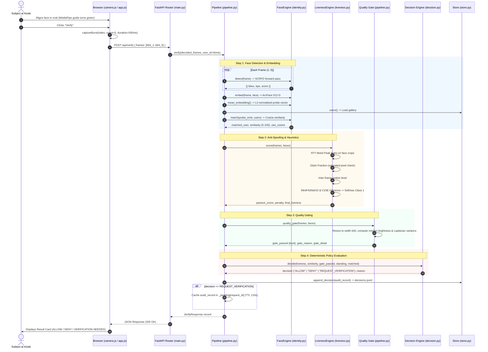
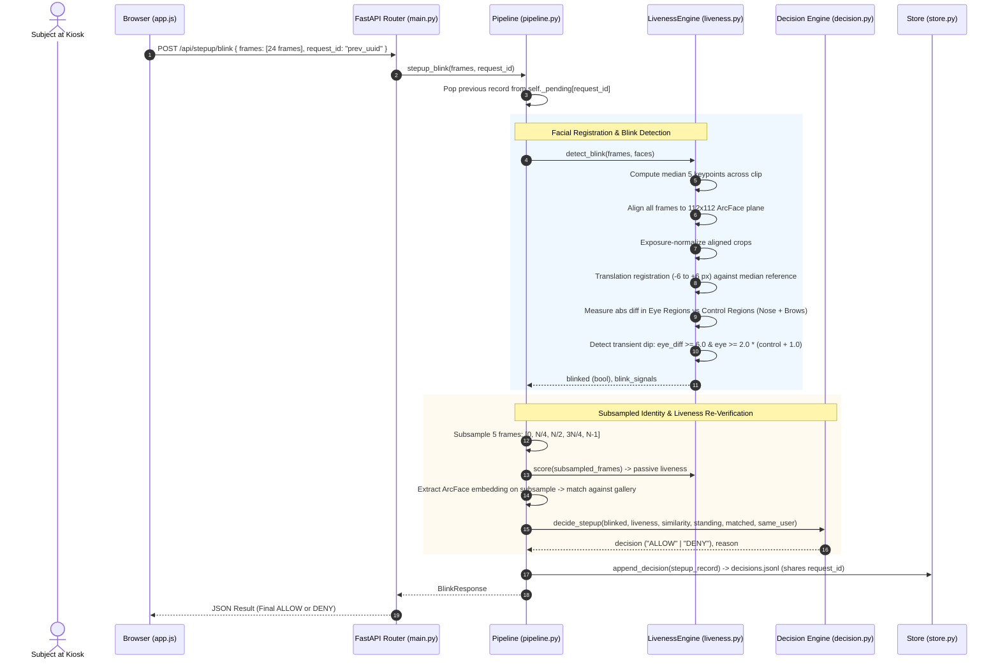

# Spot-a-Spoof: Complete Architectural and Code-Level Context Handoff Document

> **Target Audience:** Senior AI / Systems Engineers taking over development, maintenance, or audit of the Spot-a-Spoof codebase without access to the local runtime environment.  
> **Status:** Phase 1 Complete (Fully functional local edge prototype). Phase 2 (AWS Rekognition Cloud Hybrid) stubbed.

---

## 1. System Overview & Core Purpose

### 1.1 What It Is
**Spot-a-Spoof** is a standalone, local-first facial liveness and biometric identity verification kiosk prototype developed for the HID Hackathon. Designed for deployment at physical access control points (turnstiles, entry gates, kiosk terminals), it evaluates video streams captured from standard consumer webcams and issues one of three authoritative decisions:
1. `ALLOW`: High confidence that the subject is a live human being **and** matches an enrolled authorized user in good standing.
2. `REQUEST_VERIFICATION`: Inconclusive evidence (e.g., poor image brightness, severe motion blur, low confidence in liveness, or marginal facial similarity). Prompts the subject for an interactive challenge-response (Blink Step-Up).
3. `DENY`: Unambiguous failure (e.g., spoof attack detected, live subject not enrolled, user account administratively suspended, or failed step-up).

The core operational principle is **fail-secure**: uncertain conditions never collapse into an `ALLOW`.

### 1.2 Architectural Style
- **Edge-First Monolithic Application:** A unified Python backend using **FastAPI** serves both JSON REST APIs and static single-page application (SPA) frontends.
- **Client-Assisted Edge Sensing:** The browser runs client-side MediaPipe Face Detection to guide user positioning with an interactive oval overlay before submitting bursts of JPEG frames via HTTP POST.
- **Pure ONNX Inference Pipeline:** Computer vision and neural inference run strictly in-process on CPU via **ONNX Runtime** and **OpenCV** (headless). Upstream PyTorch weights (`MiniFASNet` and InsightFace `SCRFD`/`ArcFace`) are executed without requiring Python C++ extensions or CUDA GPUs.
- **File-Based Embedded Storage:** Biometric galleries, append-only decision audit logs, test clips, and evaluation metrics are persisted locally as JSON and JSON Lines (JSONL) with file locking and atomic temporary writes.

### 1.3 Current Operational Status
- **Phase 1 (Local Mode): Production-ready Hackathon Prototype.** Fully functional and verified. All 34 integration/unit tests pass; end-to-end enrollment, verification, blink step-up, spoof lab recording, and metrics evaluation are operational.
- **Phase 2 (AWS Hybrid Mode): Stubbed.** AWS Rekognition integration (`backend.identity.RekognitionIdentity`) exists as an uninstantiated stub raising `NotImplementedError`. Running with `MODE=aws` emits a warning and safely defaults to `local`.

---

## 2. Annotated Directory & File Tree

```
D:\7TH SEM\HID3\
├── PROJECT_CONTEXT_DUMP.md          # [Current File] Master architectural audit and handoff specification.
└── HID-Hackathon\
    ├── .gitignore                   # Excludes virtualenvs, bytecode, test fixtures, models/buffalo_sc, and runtime data.
    ├── DEMO.md                      # 3-minute hackathon presentation script, live failure contingencies, and talking points.
    ├── NOTICE                       # Attribution and non-commercial research licensing notices for InsightFace and Minivision models.
    ├── README.md                    # Primary repository documentation covering architecture, setup, thresholds, and benchmark notes.
    ├── requirements.lock            # Exact pinned dependency lockfile generated for Python 3.11 environments.
    ├── requirements.txt             # Loose semantic dependency specifications compatible with Python 3.10 and 3.11.
    ├── backend\
    │   ├── __init__.py              # Package marker for the backend module.
    │   ├── config.py                # System-wide static constants, heuristics bounds, anchor points, directory paths, and timeouts.
    │   ├── decision.py              # Pure, deterministic decision rule engines for first-pass verification and blink step-up.
    │   ├── evaluate.py              # Offline test harness that replays lab clips, evaluates accuracy/FAR/FRR, and writes metrics.json.
    │   ├── identity.py              # SCRFD face detection, ArcFace face alignment/embedding, cosine similarity mapping, and 1:N matcher.
    │   ├── liveness.py              # MiniFASNet ensemble, FFT moiré analysis, glare/motion heuristics, and blink step-up detector.
    │   ├── main.py                  # FastAPI application bootstrap, route definitions, lifespan initialization, and error handling.
    │   ├── models.py                # Pydantic v2 data models, request/response schemas, string constraints, and type aliases.
    │   ├── pipeline.py              # Unified pipeline orchestrator linking quality gate, liveness, identity, policy, and audit logging.
    │   └── store.py                 # Thread-safe disk persistence layer managing gallery.json, decisions.jsonl, and lab clips.
    ├── data\
    │   ├── decisions.jsonl          # Append-only audit log recording every verification attempt, step-up, latency, and telemetry signal.
    │   ├── expected.json            # Lab test manifest tracking recorded test clips, lighting conditions, and ground-truth decisions.
    │   ├── gallery.json             # Enrolled user identity store containing user IDs, names, standings, and 512-D ArcFace float vectors.
    │   ├── metrics.json             # Output artifact from the evaluation harness containing aggregate and per-clip-type performance.
    │   └── lab\
    │       └── .gitkeep             # Git keep file preserving the local clip storage directory structure.
    ├── frontend\
    │   ├── enrol.html               # Operator UI for registering new users, managing standing, and viewing enrolled identities.
    │   ├── index.html               # Primary kiosk interface with camera view, face oval guide, result card, and blink modal.
    │   ├── lab.html                 # Research UI for capturing and categorizing benchmark clips (live, print, screen, video, mask).
    │   └── metrics.html             # Performance dashboard rendering FAR/FRR metrics, latency percentiles, and Chart.js visualizations.
    ├── models\
    │   ├── .gitkeep                 # Git keep file for models directory.
    │   ├── minifasnet_v1se.onnx     # MiniFASNetV1SE anti-spoofing model (crop scale 4.0, 80x80 BGR input, 3-class logits).
    │   ├── minifasnet_v2.onnx       # MiniFASNetV2 anti-spoofing model (crop scale 2.7, 80x80 BGR input, 3-class logits).
    │   └── buffalo_sc\
    │       ├── det_500m.onnx        # SCRFD lightweight face detector from InsightFace (640x640 input, 9 output heads).
    │       └── w600k_mbf.onnx       # MobileFaceNet ArcFace feature extractor (112x112 aligned face input -> 512-D embedding).
    ├── static\
    │   ├── app.js                   # Kiosk UI controller handling webcam loop, burst sampling, verify requests, and blink step-up flow.
    │   ├── camera.js                # Shared client-side library: MediaPipe Face Detection worker, canvas frame grabber, and API fetch client.
    │   ├── enrol.js                 # Enrollment page controller capturing 5-frame bursts and issuing PATCH/DELETE identity mutations.
    │   ├── lab.js                   # Lab page controller managing test recording, individual clip execution, and deletion.
    │   ├── metrics.js               # Dashboard controller polling /api/metrics, rendering aggregate tables, and drawing Chart.js charts.
    │   └── style.css                # Minimal, zero-dependency dark-mode CSS design system for all 4 UI pages.
    ├── tests\
    │   ├── test_decision.py         # Unit tests covering the pure decision policy rules, priority order, and boundary conditions.
    │   ├── test_pipeline.py         # End-to-end integration tests using synthetic bursts against real/fake/group image fixtures.
    │   ├── test_store.py            # Unit tests verifying thread-safe store mutations, JSON atomic writes, and schema validations.
    │   └── fixtures\
    │       ├── group.jpg            # Public InsightFace test photo with multiple faces for distant/cluttered face testing.
    │       ├── image_F1.jpg         # Minivision public spoof photo #1 (printed photo / 2D attack).
    │       ├── image_F2.jpg         # Minivision public spoof photo #2 (screen replay attack matching enrolled target).
    │       └── image_T1.jpg         # Minivision public authentic test photo (live subject target for enrollment tests).
    └── tools\
        ├── convert_minifasnet.py    # Offline utility script converting upstream PyTorch .pth weights into ONNX format.
        └── fetch_models.py          # Network downloader that fetches buffalo_sc.zip and test fixtures, verifying SHA-256 hashes.
```

---

## 3. Tech Stack, Dependencies & Environment Setup

### 3.1 Languages & Runtimes
- **Python:** 3.10 or 3.11 (64-bit). *Note: Python 3.14 is unsupported due to absence of pre-compiled wheels for NumPy 1.26 and ONNX Runtime.*
- **JavaScript:** Vanilla ECMAScript 2020+ (No Node.js, Webpack, or npm build step required).
- **HTML5/CSS3:** Modern CSS custom properties (variables), Flexbox/Grid, zero external framework dependencies.

### 3.2 Core Libraries & Frameworks
| Dependency | Version Range | Purpose & Architectural Justification |
|---|---|---|
| `fastapi` | `==0.115.*` | Core ASGI web framework providing route dispatching, dependency injection, and automatic OpenAPI validation. |
| `uvicorn[standard]` | `==0.30.*` | High-performance ASGI server; provides `uvloop`/`httptools` on supported platforms and WebSocket protocol handling. |
| `pydantic` | `==2.*` | Request/response data validation and strict serialization (`model_config = ConfigDict(extra="forbid")`). |
| `opencv-python-headless` | `==4.10.*` | Image transformations, color space conversions (`BGR2GRAY`), affine warping (`warpAffine`), Laplacian variance, FFT. |
| `numpy` | `==1.26.*` | Vectorized mathematical operations, matrix decompositions (SVD for Umeyama alignment), percentiles, cosine similarity. |
| `onnxruntime` | `==1.18.*` | CPU neural inference engine for SCRFD (`det_500m`), ArcFace (`w600k_mbf`), and MiniFASNet (`v1se`, `v2`). |
| `pytest` | `==8.*` | Test runner for unit, policy grid, and end-to-end pipeline integration testing. |
| `httpx` | `==0.27.*` | HTTP client powering FastAPI's `TestClient` in `test_pipeline.py`. |
| `boto3` / `botocore` | `==1.34.*` | AWS SDK installed for future Phase 2 cloud hybrid migration (`RekognitionIdentity`). |

#### Critical Dependency Architecture Decision: Why InsightFace Python Package is NOT Used
The official `insightface` Python wheel (v0.7.3) requires Microsoft Visual C++ 14.0+ Build Tools to compile Cython extensions on Windows. To ensure zero-friction setup on standard Windows workstations, this project bypasses the `insightface` Python library entirely. Instead, `backend/identity.py` directly executes the underlying InsightFace ONNX models using `onnxruntime`, reimplementing the SCRFD anchor decoding, Non-Maximum Suppression (`_nms`), Umeyama 5-point landmark alignment (`_umeyama`), and ArcFace preprocessing in pure NumPy and OpenCV.

### 3.3 External CDN Dependencies (Frontend)
- **MediaPipe Face Detection (`0.4.1646425229`):** Loaded via jsDelivr CDN (`https://cdn.jsdelivr.net/npm/@mediapipe/face_detection@...`). Runs client-side WASM/WebGL face tracking to drive the oval positioning guide. If the client is offline, the frontend falls back gracefully to server-side gating.
- **Chart.js (`4.4.3`):** Loaded via jsDelivr CDN on `/metrics` for rendering stacked bar charts of decision distributions.

### 3.4 Environment Variables & Configuration Flags
Configurations are loaded in `backend/config.py`:
- `SPOOF_DATA_DIR` (Path): Overrides root data directory. Default: `<PROJECT_ROOT>/data`.
- `SPOOF_MODELS_DIR` (Path): Overrides models directory. Default: `<PROJECT_ROOT>/models`.
- `MODE` (String): `"local"` (default) or `"aws"`. Currently, `"aws"` emits a warning and defaults to local execution.

### 3.5 Build & Execution Commands

```powershell
# 1. Navigate to repository root
cd "D:\7TH SEM\HID3\HID-Hackathon"

# 2. Initialize and activate Python virtual environment
py -3.10 -m venv .venv
.venv\Scripts\activate

# 3. Install dependencies (use requirements.txt on Python 3.10, or requirements.lock on Python 3.11)
pip install -r requirements.txt

# 4. Fetch ONNX model weights and sample test fixtures (SHA256 verified)
python tools/fetch_models.py --samples

# 5. Start the ASGI web server
uvicorn backend.main:app --host 127.0.0.1 --port 8000

# 6. Execute full automated test suite (34 tests)
pytest tests/

# 7. Execute offline benchmark evaluation harness
python -m backend.evaluate
```

---

## 4. End-to-End Execution & Data Flow

### 4.1 System Bootstrap & Lifespan Lifecycle
1. **Entry Point:** The server is started via `uvicorn backend.main:app --host 127.0.0.1 --port 8000`.
2. **Lifespan Context (`backend/main.py:lifespan`):**
   - The ASGI lifespan context manager triggers before incoming requests are accepted.
   - Instantiates a singleton `Pipeline` object: `state["pipeline"] = Pipeline()`.
   - `Pipeline.__init__()` initializes:
     - `Store`: Verifies `data/` and `data/lab/` directories, configures JSON file paths.
     - `FaceEngine`: Initializes ONNX runtime inference sessions for `det_500m.onnx` and `w600k_mbf.onnx` with `CPUExecutionProvider` and log severity level 3. If models are missing or corrupted, catches exception, sets `self.error`, logs an error, and initializes OpenCV `haarcascade_frontalface_default.xml` as a fallback detector while disabling identity matching.
     - `LivenessEngine`: Initializes ONNX runtime inference sessions for `minifasnet_v2.onnx` and `minifasnet_v1se.onnx`. If loading fails, sets mode to `"heuristic"` and logs an error.
     - `_pending`: Initializes an empty dictionary protected by `threading.Lock()` to store pending verification attempts awaiting a blink step-up.
3. **Shutdown:** FastAPI completes requests and cleans up resources on SIGINT/SIGTERM.

---

### 4.2 Primary Request Flow 1: 1:N Verification (`POST /api/verify`)



#### Detailed Stage Logic:
1. **Frame Ingestion:** `decode_frames()` parses Base64 strings (with or without `data:image/jpeg;base64,` URI prefixes) into OpenCV BGR NumPy arrays (`uint8`). Validates dimensions $\ge 64\times 64$.
2. **Face Detection (`FaceEngine.detect`):**
   - Letterboxes frame to $640\times 640$ preserving aspect ratio.
   - Normalizes via `cv2.dnn.blobFromImage(canvas, 1/128, (640, 640), (127.5, 127.5, 127.5), swapRB=True)`.
   - Runs `det_500m.onnx`. Parses 9 output tensors corresponding to strides 8, 16, 32 across 2 anchors per location.
   - Extracts bounding boxes (`bbox`), 5 facial landmarks (`kps`), and confidence scores. Applies NMS at threshold 0.4.
3. **Face Feature Extraction (`FaceEngine.embed`):**
   - Warps the detected face using a least-squares similarity transformation matrix derived via the Umeyama algorithm (`_umeyama`) mapping the 5 keypoints to standard ArcFace landmark anchors on a $112\times 112$ plane.
   - Normalizes: `cv2.dnn.blobFromImage(aligned, 1/127.5, (112, 112), (127.5, 127.5, 127.5), swapRB=True)`.
   - Runs `w600k_mbf.onnx` to generate a 512-dimensional vector; applies $L_2$ normalization.
4. **Gallery Matching (`identity.py:match`):**
   - Averages valid probe embeddings across the burst: $\mathbf{e}_{\text{probe}} = \frac{\sum \mathbf{e}_i}{\|\sum \mathbf{e}_i\|_2}$.
   - Computes dot product (cosine similarity) against all active/suspended users: $\text{cos} = \mathbf{e}_{\text{probe}} \cdot \mathbf{e}_{\text{gallery}}$.
   - Maps raw cosine to a 0–100 scale using piecewise linear interpolation (`scale_similarity`) anchored at:
     - $\text{cos} \le 0.0 \rightarrow 0.0$
     - $\text{cos} = 0.30 \rightarrow 80.0$ (Minimum threshold to count as enrolled)
     - $\text{cos} = 0.50 \rightarrow 95.0$ (Threshold to allow identity)
     - $\text{cos} = 1.00 \rightarrow 100.0$
5. **Passive Anti-Spoofing (`LivenessEngine.score`):**
   - Crops face regions using scale 2.7 (V2) and 4.0 (V1SE) into $80\times 80$ BGR images.
   - Evaluates ONNX graphs, extracts softmax probabilities for Class 1 ("real"), and computes the median across frames.
   - Computes heuristic penalties:
     - **Moiré Peak Ratio:** 2D FFT on a Hanning-windowed $128\times 128$ grayscale crop. Measures maximum spectral energy in the mid/high frequency band ($\frac{N}{8} \le r < \frac{N}{2}$) relative to the radial ring mean. Ramped between 8.0 and 20.0.
     - **Glare Fraction:** Fraction of pixels where $\min(B, G, R) \ge 250$. Ramped between 0.02 and 0.10.
     - **Static Motion:** Inter-frame mean absolute difference on downscaled $64\times 64$ crops. If motion $< 0.15$ gray levels, triggers static frame penalty.
     - Aggregate penalty: $\text{penalty} = \min(0.6, 0.5 \cdot s_{\text{moire}} + 0.3 \cdot s_{\text{glare}} + 0.2 \cdot s_{\text{static}})$.
     - Final score: $\text{liveness} = \text{passive} \cdot (1 - \text{penalty})$.
6. **Quality Gate (`quality_gate`):**
   - Requires at least one detected face.
   - Downscales frame to width 640. Evaluates median grayscale brightness ($60 \le B \le 200$) and Laplacian variance ($S > 100$).
7. **Decision Policy (`decision.py:decide`):**
   Evaluated strictly in priority order:
   - Rule 1: `standing == "suspended"` $\rightarrow$ `DENY` ("User suspended")
   - Rule 2: `matched and liveness < 0.40` $\rightarrow$ `DENY` ("Spoof detected")
   - Rule 3: `not matched and gate_passed and liveness >= 0.85` $\rightarrow$ `DENY` ("Live person, identity not enrolled")
   - Rule 4: `gate_passed and matched and liveness >= 0.85 and similarity >= 95.0` $\rightarrow$ `ALLOW` ("Live person and identity verified")
   - Rule 5: `not gate_passed` $\rightarrow$ `REQUEST_VERIFICATION` ("Poor image quality")
   - Rule 6: Fallthrough $\rightarrow$ `REQUEST_VERIFICATION` ("Low confidence")

---

### 4.3 Primary Request Flow 2: Blink Step-Up (`POST /api/stepup/blink`)

When a user receives `REQUEST_VERIFICATION`, the browser displays a step-up panel. The user clicks "Start blink check", a 3-second countdown elapses, and the browser records 24 frames over 2.2 seconds (sampling rate $\approx 11$ FPS at $480\times 360$, JPEG quality 0.8).



#### Step-Up Policy (`decision.py:decide_stepup`):
Never returns `REQUEST_VERIFICATION`. Only two outcomes:
- Rule 1: `standing == "suspended"` $\rightarrow$ `DENY` ("User suspended")
- Rule 2: `liveness < 0.40` $\rightarrow$ `DENY` ("Spoof detected")
- Rule 3: `not blinked` $\rightarrow$ `DENY` ("Step-up failed: no blink detected")
- Rule 4: `not matched or not same_user` $\rightarrow$ `DENY` ("Step-up failed: identity not confirmed")
- Rule 5: `similarity >= 95.0 and liveness >= 0.60` $\rightarrow$ `ALLOW` ("Step-up passed: blink confirmed")
- Rule 6: Fallthrough $\rightarrow$ `DENY` ("Step-up failed: low confidence")

---

### 4.4 Primary Request Flow 3: User Enrollment (`POST /api/enrol`)
1. User enters name and faces camera; client checks that MediaPipe face gate is centered.
2. Client captures exactly 5 frames over 2.0 seconds (`captureBurst(video, 5, 2000)`).
3. Payload is sent to `POST /api/enrol`.
4. `Pipeline.enrol(name, frames)`:
   - Validates that `FaceEngine.identity_available` is True.
   - Detects a face in every frame (rejects with HTTP 400 `FrameError` if any frame lacks a face).
   - Validates `quality_gate(frames, faces)` (rejects with HTTP 400 if dark, blurry, or poor quality).
   - Computes ArcFace embedding for each frame and calculates normalized mean embedding vector $\mathbf{e} \in \mathbb{R}^{512}$.
   - Appends user to `data/gallery.json` under file lock with ID `u_NNN` (monotonically incrementing), status `"active"`, and current ISO UTC timestamp.

---

### 4.5 Primary Request Flow 4: Evaluation Benchmark Harness (`POST /api/evaluate` / CLI)
1. Invoked via `python -m backend.evaluate` or `POST /api/evaluate`.
2. Reads `data/expected.json` containing recorded test clips.
3. For each clip, reads stored JPEG frames from `data/lab/<clip_name>/frame_*.jpg`. Subsamples to 5 evenly spaced frames.
4. Performs a single dry-run inference on the first clip to eliminate model warm-up artifacts from latency measurements.
5. Runs `Pipeline.verify(frames, clip_label=name, source="harness")`.
6. Evaluates actual vs. expected decisions:
   - **False Acceptance Rate (FAR):** $\frac{\text{Spoof clips decided ALLOW}}{\text{Total spoof clips}}$.
   - **False Rejection Rate (FRR):** $\frac{\text{Live enrolled clips decided DENY}}{\text{Total live enrolled clips expected ALLOW}}$. *(Note: Live enrolled clips yielding `REQUEST_VERIFICATION` are counted as step-ups, not false rejects).*
   - **Accuracy:** $\frac{\text{Clips where actual == expected}}{\text{Total clips evaluated}}$.
   - **Latency:** Computes median ($p50$) and 95th percentile ($p95$) execution times in milliseconds.
7. Atomically saves full metric breakdown to `data/metrics.json`.

---

## 5. Deep-Dive Module & Code Breakdown

### 5.1 `backend/config.py`
Static system constants and tuning parameters.
- **Paths:** `ROOT`, `DATA_DIR`, `MODELS_DIR`, `FRONTEND_DIR`, `STATIC_DIR`.
- **Quality Gate:** `GATE_WIDTH = 640`, `BRIGHTNESS_MIN = 60.0`, `BRIGHTNESS_MAX = 200.0`, `SHARPNESS_MIN = 100.0` (Laplacian variance threshold).
- **MiniFASNet Configuration:** `FAS_MODELS = [("minifasnet_v2.onnx", 2.7), ("minifasnet_v1se.onnx", 4.0)]`, `FAS_INPUT_SIZE = 80`, `FAS_REAL_INDEX = 1`.
- **Heuristic Weights & Thresholds:**
  - `MOIRE_RATIO_LOW = 8.0`, `MOIRE_RATIO_HIGH = 20.0`
  - `GLARE_FRAC_LOW = 0.02`, `GLARE_FRAC_HIGH = 0.10`
  - `MOTION_STATIC_LOW = 0.15`, `MOTION_STATIC_HIGH = 0.6`
  - Linear penalty weights: `W_MOIRE = 0.5`, `W_GLARE = 0.3`, `W_STATIC = 0.2`
  - Bounds: `HEURISTIC_PENALTY_CAP = 0.6`, `HEURISTIC_ONLY_CAP = 0.80`.
- **Identity Metric Scaling:**
  - `COSINE_ANCHORS = [0.0, 0.30, 0.50, 1.0]`
  - `SIMILARITY_ANCHORS = [0.0, 80.0, 95.0, 100.0]`
  - `MATCH_MIN_SIMILARITY = 80.0`
- **Blink Parameters:** `BLINK_MIN_FRAMES = 8`, `BLINK_MAX_FRAMES = 30`, `BLINK_EYE_DIFF_MIN = 6.0`, `BLINK_EYE_TO_CONTROL = 2.0`, `STEPUP_TTL_S = 120`.

### 5.2 `backend/decision.py`
Pure, functional decision policy logic. Contains zero I/O operations or external imports.
- `decide(liveness: float, similarity: float, gate_passed: bool, standing: Optional[str], matched: bool) -> tuple[str, str]`
  - Deterministic evaluation tree returning `(decision, reason)`.
- `decide_stepup(blinked: bool, liveness: float, similarity: float, standing: Optional[str], matched: bool, same_user: bool) -> tuple[str, str]`
  - Final adjudication after blink step-up.
- `thresholds() -> dict`
  - Exports operational thresholds (`liveness_allow: 0.85`, `liveness_deny: 0.40`, `similarity_allow: 95.0`, `stepup_liveness_min: 0.60`).

### 5.3 `backend/identity.py`
Facial detection, landmark alignment, ArcFace feature representation, and similarity mapping.
- `_umeyama(src: np.ndarray, dst: np.ndarray) -> np.ndarray`
  - Least-squares estimation of transformation parameters mapping source landmarks onto canonical ArcFace target anchors. Uses Singular Value Decomposition (`np.linalg.svd`).
- `align_face(img: np.ndarray, kps: np.ndarray, size: int = 112) -> np.ndarray`
  - Applies affine transform (`cv2.warpAffine`) using Umeyama transformation matrix to yield normalized $112\times 112$ face crop.
- `_nms(dets: np.ndarray, thresh: float) -> list[int]`
  - Vectorized Non-Maximum Suppression filtering overlapping detection boxes based on Intersection-over-Union (IoU).
- `class FaceEngine`
  - Attributes: `det` (InferenceSession), `rec` (InferenceSession), `haar` (CascadeClassifier), `error` (Optional[str]).
  - `detect(img: np.ndarray) -> list[dict]`
    - Preprocesses image into $640\times 640$ letterbox, executes SCRFD forward pass across strides 8, 16, 32. Extracts bounding boxes, 5-point facial keypoints, and confidence scores. Returns sorted list of detected faces (largest area first).
  - `embed(img: np.ndarray, face: dict) -> Optional[np.ndarray]`
    - Aligns face via `align_face`, runs ArcFace forward pass, normalizes to unit length ($L_2$). Returns 512-D float32 array.
- `mean_embedding(embeddings: list[np.ndarray]) -> Optional[np.ndarray]`
  - Element-wise arithmetic mean of valid embeddings followed by $L_2$ renormalization.
- `scale_similarity(cosine: float) -> float`
  - Piecewise linear interpolation mapping raw cosine similarity $[-1.0, 1.0]$ to policy domain $[0.0, 100.0]$.
- `match(embedding: np.ndarray, users: list[dict], user_id: Optional[str] = None) -> tuple[Optional[dict], float, float]`
  - Performs 1:1 or 1:N dot product search against enrolled gallery embeddings. Returns `(matched_user_dict, similarity_0_to_100, raw_cosine)`.
- `class RekognitionIdentity`
  - Unimplemented Phase 2 AWS client stub.

### 5.4 `backend/liveness.py`
Passive anti-spoofing ensemble, frequency domain heuristic analysis, and blink tracking.
- `crop_for_fas(img: np.ndarray, bbox: list[float], scale: float, size: int = 80) -> np.ndarray`
  - Computes expanded bounding box scaled by factor (2.7 or 4.0), pads borders, and resizes to $80\times 80$ BGR image matching MiniFASNet training distribution.
- `moire_peak_ratio(crop: np.ndarray) -> float`
  - Computes 2D Fast Fourier Transform (`np.fft.fft2`) on Hanning-windowed grayscale crop. Applies Gaussian smoothing on magnitude spectrum and computes the ratio of peak frequency energy within the annular ring ($\frac{N}{8} \le r < \frac{N}{2}$) to average ring energy.
- `glare_fraction(crop: np.ndarray) -> float`
  - Calculates percentage of pixels where all three color channels reach saturation ($\min(B, G, R) \ge 250$).
- `motion_level(frames: list[np.ndarray], bbox: list[float]) -> Optional[float]`
  - Computes average pixel difference between consecutive aligned face crops scaled to $64\times 64$.
- `class LivenessEngine`
  - Attributes: `sessions` (list of `(InferenceSession, input_name, crop_scale)`), `error` (Optional[str]).
  - `passive_frame(img: np.ndarray, bbox: list[float]) -> float`
    - Evaluates both MiniFASNet models, applies softmax to logits, averages probability distributions, and extracts probability of Class 1 ("real").
  - `score(frames: list[np.ndarray], faces: list[Optional[dict]]) -> tuple[float, dict]`
    - Computes median passive score across burst and applies combined heuristic penalty for moiré patterns, glare, and static frames.
- `detect_blink(frames: list[np.ndarray], faces: list[Optional[dict]]) -> tuple[bool, dict]`
  - Aligns all frames using a single shared landmark set (median landmarks across the clip to prevent eye closure from smearing alignment).
  - Performs 2D translation registration over a search window $[-6, 6]$ pixels against median reference frame.
  - Computes mean absolute intensity changes in left/right eye slices relative to control slices (eyebrows and nose bridge).
  - Confirms blink if transient dip occurs ($1 \le n_{\text{frames}} \le \frac{N}{2}$) with $\Delta_{\text{eye}} \ge 6.0$ and $\Delta_{\text{eye}} \ge 2.0 \cdot (\Delta_{\text{control}} + 1.0)$.

### 5.5 `backend/pipeline.py`
Pipeline orchestrator and entry point for verification workflows.
- `decode_frames(frames_b64: list[str]) -> list[np.ndarray]`
  - Parses and validates Base64 frame payloads. Enforces image dimension bounds.
- `quality_gate(frames: list[np.ndarray], faces: list[Optional[dict]]) -> tuple[bool, str, dict]`
  - Downscales frames to width 640. Evaluates face presence, median grayscale brightness ($[60, 200]$), and Laplacian variance ($> 100$).
- `class Pipeline`
  - Attributes: `store` (Store), `faces` (FaceEngine), `liveness` (LivenessEngine), `_pending` (dict), `_lock` (Lock).
  - `status() -> dict`: Returns runtime health, active mode, and model errors.
  - `verify(frames, user_id=None, clip_label=None, source="kiosk") -> dict`: Executes full verification pass and writes audit record.
  - `stepup_blink(frames, request_id=None) -> dict`: Evaluates blink challenge, links to pending request, and records final outcome.
  - `enrol(name: str, frames: list[np.ndarray]) -> dict`: Validates quality, calculates mean ArcFace embedding, and writes to gallery.

### 5.6 `backend/store.py`
Thread-safe persistence layer using `threading.RLock()` and atomic temporary file swapping.
- `Store(data_dir=None)`:
  - `gallery_path`: `data/gallery.json`
  - `decisions_path`: `data/decisions.jsonl`
  - `expected_path`: `data/expected.json`
  - `metrics_path`: `data/metrics.json`
  - `lab_dir`: `data/lab/`
- Key Methods:
  - `users() -> list[dict]`: Loads gallery JSON.
  - `add_user(name, embedding, standing="active") -> dict`: Generates `u_NNN` ID, stores rounded 6-decimal float vector, atomically replaces `gallery.json`.
  - `set_standing(user_id, standing) -> Optional[dict]`: Updates standing to `"active"` or `"suspended"`.
  - `delete_user(user_id) -> bool`: Removes user from gallery.
  - `append_decision(record: dict)`: Thread-safe append to `decisions.jsonl`.
  - `read_decisions() -> list[dict]`: Reads and parses full JSONL audit log.
  - `add_clip(meta: dict, jpeg_frames: list[bytes]) -> dict`: Saves individual frame JPEGs under `data/lab/<clip_name>/` and updates `expected.json`.
  - `delete_clip(name: str) -> bool`: Deletes clip directory, files, and manifest entry.

### 5.7 `backend/evaluate.py`
Offline performance evaluation engine.
- `load_clip(store: Store, name: str) -> list[np.ndarray]`: Reads stored JPEG files from disk and subsamples up to 5 frames.
- `summarise(rows: list[dict]) -> dict`: Calculates counts, accuracy, FAR, FRR, genuine step-ups, and $p50$/$p95$ latencies.
- `run_harness(pipeline: Pipeline) -> dict`: Iterates through all test clips in `expected.json`, executes `pipeline.verify()`, calculates aggregate statistics, and writes `data/metrics.json`.
- `format_table(metrics: dict) -> str`: Renders ASCII terminal report table.

### 5.8 `backend/main.py`
FastAPI application router and entry point.
- Lifespan handler registers pipeline on startup.
- Configures static file serving from `static/` mounted at `/static`.
- Implements route handlers mapping HTTP requests to pipeline operations.

---

## 6. Data Models, Schemas & State Management

### 6.1 Persistent Storage Schemas

#### `data/gallery.json`
```json
{
  "users": [
    {
      "id": "u_001",
      "name": "Alice Smith",
      "standing": "active",
      "enrolled_at": "2026-11-14T06:12:35.210+00:00",
      "embedding": [-0.009308, -0.054721, "...", 0.024482] // 512 float values
    }
  ]
}
```

#### `data/decisions.jsonl` (Append-Only Audit Log)
Each line represents an independent verification or step-up event:
```json
{
  "ts": "2026-11-14T06:12:50.237+00:00",
  "request_id": "dd3d7bb952ee4bbab6ff614676fa4780",
  "stage": "verify",
  "source": "kiosk",
  "decision": "ALLOW",
  "reason": "Live person and identity verified",
  "liveness": 0.994,
  "liveness_mode": "ensemble",
  "similarity": 99.68,
  "matched_user": "u_001",
  "matched_name": "Alice Smith",
  "standing": "active",
  "claimed_user": null,
  "gate_passed": true,
  "gate_reason": "ok",
  "clip_label": null,
  "frames": 5,
  "signals": {
    "passive": 0.994,
    "passive_per_frame": [0.994, 0.9972, 0.9938, 0.9949, 0.9912],
    "moire_ratio": 4.42,
    "glare_fraction": 0.0002,
    "motion": 3.104,
    "penalty": 0.0,
    "cosine": 0.968,
    "brightness": 88.4,
    "sharpness": 232.7,
    "frames_with_face": 5
  },
  "latency_ms": 493.6
}
```

#### `data/expected.json` (Lab Test Manifest)
```json
{
  "conditions": {
    "notes": "Evaluation test suite"
  },
  "clips": [
    {
      "name": "print_alice_daylight_01",
      "type": "print",
      "person": "alice",
      "enrolled": true,
      "lighting": "daylight",
      "expected": "DENY",
      "notes": "Laser print on matte paper",
      "recorded_at": "2026-11-14T06:15:00.000+00:00"
    }
  ]
}
```

### 6.2 In-Memory Pydantic Schemas (`backend/models.py`)
All request schemas inherit from `StrictModel` (`ConfigDict(extra="forbid")`), rejecting extraneous parameters with HTTP 422.
- `VerifyRequest`: `frames: list[str]` (length 3 to 5), `user_id: Optional[str]`, `clip_label: Optional[str]`.
- `VerifyResponse`: `decision: str`, `reason: str`, `liveness: float`, `similarity: float`, `matched_user: Optional[str]`, `latency_ms: float`, `gate_passed: bool`, `liveness_mode: str`, `request_id: str`, `matched_name: Optional[str]`, `gate_reason: str`, `signals: dict`.
- `EnrolRequest`: `name: str` (1–60 chars), `frames: list[str]` (strictly 5 frames).
- `EnrolResponse`: `user_id: str`, `status: str`.
- `UserOut`: `id: str`, `name: str`, `standing: "active" | "suspended"`.
- `StandingUpdate`: `standing: "active" | "suspended"`.
- `BlinkRequest`: `frames: list[str]` (length 8 to 30 frames), `request_id: Optional[str]`.
- `BlinkResponse`: `blinked: bool`, `liveness: float`, `decision: Optional[str]`, `reason: Optional[str]`, `request_id: Optional[str]`, `similarity: Optional[float]`, `matched_user: Optional[str]`, `signals: dict`.
- `ClipCreate`: `type: "live" | "print" | "screen" | "video" | "mask" | "poor_quality"`, `person: str`, `enrolled: bool`, `lighting: str`, `expected: Optional[str]`, `notes: Optional[str]`, `frames: list[str]` (length 3 to 5).

---

## 7. API Surface / Interfaces

### 7.1 Web UI Endpoints (HTML Pages)
- `GET /`: Serves `frontend/index.html` (Kiosk verification interface).
- `GET /enrol`: Serves `frontend/enrol.html` (Operator user enrollment and identity table).
- `GET /lab`: Serves `frontend/lab.html` (Spoof recording studio and individual clip runner).
- `GET /metrics`: Serves `frontend/metrics.html` (Accuracy, FAR/FRR metrics dashboard, Chart.js graphs).

### 7.2 REST API Endpoints

| Method | Route | Input Schema / Params | Output Schema / Status | Description |
|---|---|---|---|---|
| `GET` | `/api/status` | None | `{ mode, liveness_mode, liveness_error, identity_available, identity_error }` | Returns backend hardware/model operational readiness. |
| `POST` | `/api/verify` | `VerifyRequest` (JSON) | `VerifyResponse` (200 OK) | Evaluates 3–5 frames for quality, liveness, identity match, and policy decision. |
| `POST` | `/api/stepup/blink` | `BlinkRequest` (JSON) | `BlinkResponse` (200 OK) | Evaluates 8–30 frames for eye blink challenge and resolves pending verification. |
| `POST` | `/api/enrol` | `EnrolRequest` (JSON) | `EnrolResponse` (200 OK) | Captures 5 frames, extracts average ArcFace embedding, stores new identity. |
| `GET` | `/api/users` | None | `list[UserOut]` (200 OK) | Lists all enrolled users (biometric embedding vectors are stripped). |
| `PATCH` | `/api/users/{user_id}` | `StandingUpdate` (JSON) | `UserOut` (200 OK, 404 if missing) | Modifies user access standing (`active` $\leftrightarrow$ `suspended`). |
| `DELETE`| `/api/users/{user_id}` | `user_id` (path string) | `{"deleted": user_id}` (200 OK, 404 if missing) | Permanently deletes identity and embedding from gallery. |
| `GET` | `/api/lab/clips` | None | `list[dict]` (200 OK) | Lists all recorded lab test clips with metadata and frame counts. |
| `POST` | `/api/lab/clips` | `ClipCreate` (JSON) | `dict` (200 OK) | Saves a new labeled test clip under `data/lab/` and registers in `expected.json`. |
| `DELETE`| `/api/lab/clips/{name}` | `name` (path string) | `{"deleted": name}` (200 OK, 404 if missing) | Deletes clip frames from disk and unregisters from `expected.json`. |
| `POST` | `/api/lab/clips/{name}/run` | `name` (path string) | `{"expected", "actual", "correct", "result"}` | Replays a single stored lab clip through the verification pipeline. |
| `GET` | `/api/metrics` | None | `dict` (200 OK) | Aggregates kiosk logs, current thresholds, and latest harness results. |
| `POST` | `/api/evaluate` | None | `dict` (200 OK) | Executes complete benchmark harness across all clips and updates `metrics.json`. |

---

## 8. Quirks, Technical Debt, Bugs & Sharp Edges

### 8.1 Incomplete Features & Architectural Stubs
1. **Phase 2 AWS Rekognition Integration (`backend/identity.py:RekognitionIdentity`):**
   - Methods `create_collection`, `index_faces`, and `search_faces_by_image` raise `NotImplementedError`.
   - Setting `MODE=aws` in `config.py` is intercepted by `backend/main.py:lifespan` which emits a warning log and reverts execution to local mode. Cloud failover does not exist.
2. **Operator-Supervised Enrollment (`backend/pipeline.py:enrol`):**
   - The enrollment endpoint checks `quality_gate()`, but **does not check liveness**. An attacker holding up a high-quality printed photograph or screen during enrollment will be successfully registered as an enrolled identity. Enrollment is designed strictly for operator-supervised provisioning.

### 8.2 Known Algorithmic Vulnerabilities & Fragilities
1. **Blink Replay Vulnerability:**
   - The blink step-up detector (`backend/liveness.py:detect_blink`) measures differential intensity changes between eye regions and facial control regions. Consequently, a **video replay of a blinking subject displayed on a tablet or phone will pass the blink detector**.
   - The only safeguard against video replay blinks is the passive MiniFASNet score floor ($\ge 0.60$) enforced in `decide_stepup()`.
2. **Detector/Classifier Bounding Box Mismatch:**
   - InsightFace's `det_500m.onnx` (SCRFD) produces bounding boxes that differ in margin and aspect ratio from the bounding box format used to train Minivision's `MiniFASNet`. While `crop_for_fas()` applies the documented expansion ratios (2.7 and 4.0), boundary edge handling on small or off-center faces can introduce subtle variances in classification confidence.
3. **Uncalibrated Heuristic Thresholds:**
   - Moiré FFT ratio thresholds (`MOIRE_RATIO_LOW = 8.0`, `MOIRE_RATIO_HIGH = 20.0`) and glare thresholds (`0.02` to `0.10`) were derived from synthetic and static sample images. Different webcam sensors with built-in sharpening, compression artifacts, or auto-exposure hunting may trigger false heuristic penalties, depressing genuine passive liveness scores.

### 8.3 Concurrency, State, and Bottlenecks
1. **In-Memory Volatile Step-Up State (`Pipeline._pending`):**
   - Pending verification attempts awaiting a blink step-up are stored in an in-memory dictionary `self._pending[request_id] = (timestamp, record)` with a 120-second TTL.
   - **Risk 1:** Restarting the FastAPI server or Uvicorn worker destroys all active step-up tokens.
   - **Risk 2:** Running Uvicorn with multiple worker processes (`uvicorn --workers 4`) will cause step-up requests to fail with HTTP 200 (inconclusive / expired) whenever the step-up request lands on a different worker process than the initial verify request. The application must run in a single worker process or use Redis for shared state.
2. **Linear Search Bottleneck in 1:N Matching (`backend/identity.py:match`):**
   - Gallery matching iterates linearly ($O(N)$) over all users in `data/gallery.json`, computing sequential Python `np.dot` calls. For galleries with $> 10,000$ identities, this will introduce significant latency. An approximate nearest neighbors (ANN) index (e.g., FAISS, HNSW) is required for large scale.
3. **Entire File Rewrites on Mutation (`backend/store.py`):**
   - `add_user`, `set_standing`, and `delete_user` read the entire `data/gallery.json` into memory, serialize the updated list, write to a temporary file, and call `os.replace`. Under concurrent enrollment or status changes, this is an I/O bottleneck.
4. **Unbounded Append-Only Audit Log (`data/decisions.jsonl`):**
   - Every verification, lab test, and step-up appends an uncompressed JSON line. In high-traffic kiosk deployments, disk consumption will grow unbounded without an external log rotation mechanism.
5. **Browser Origin Restriction for Webcams:**
   - Web browsers (Chrome/Edge) strictly restrict `navigator.mediaDevices.getUserMedia` to secure contexts (`https://` or `http://127.0.0.1`). If the kiosk is accessed via hostname or local network IP (e.g., `http://192.168.1.50:8000`), the browser will block webcam access unless an SSL certificate is configured or a Chrome flag exception is set.
6. **Dependency Locking vs Python Version Compatibility:**
   - `requirements.lock` contains `websockets==17.4`, which requires Python $\ge 3.11$. Installing via `requirements.lock` fails on Python 3.10. Python 3.10 environments must install via `requirements.txt`.
